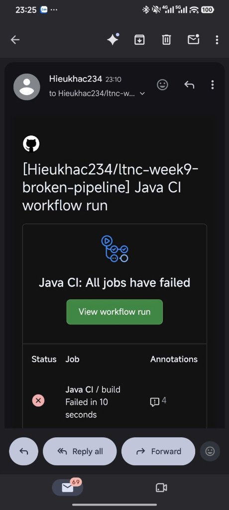

# BÁO CÁO BÀI 10: THE BROKEN PIPELINE (ROOT CAUSE ANALYSIS)

* **Họ và tên:** Nguyễn Khắc Hiếu
* **Mã sinh viên:** 25020581
* **Môn học:** UET.CS2043 - Lập trình nâng cao
* **Đường dẫn Repository GitHub:** [https://github.com/Hieukhac234/ltnc-week9-broken-pipeline](https://github.com/Hieukhac234/ltnc-week9-broken-pipeline)

---

## 1. BẰNG CHỨNG HÌNH ẢNH PIPELINE BÁO ĐỎ (LỖI THỨ 4 TỰ TẠO)

Theo đúng yêu cầu mục 3 của đề bài: *"Sau khi pipeline xanh, cố tình tạo thêm một lỗi thứ 4 tự nghĩ ra, push lên, chụp ảnh pipeline đỏ, sửa lại và giải thích."*

Dưới đây là hình ảnh email cảnh báo tự động từ hệ thống GitHub Actions thông báo toàn bộ job build bị thất bại (**Java CI: All jobs have failed**) tại commit số 5:



---

## 2. LỊCH SỬ CÁC LẦN CHẠY & COMMIT TRÊN GITHUB ACTIONS

Toàn bộ quá trình gỡ lỗi thực tế đã được đẩy lên GitHub theo đúng thứ tự logic:

| Lần chạy (Run #) | Mã Commit | Thông điệp Commit | Trạng thái | Diễn giải theo đề bài |
| :---: | :---: | :--- | :---: | :--- |
| **#1** | `5c83a14` | `ci: initial broken pipeline setup with existing bugs` | ❌ **Failed** | Pipeline ban đầu bị lỗi đỏ do Lỗi 1 có sẵn |
| **#2** | `1b9e93d` | `fix(ci): add actions/checkout step to fix missing POM error` | ❌ **Failed** | Sửa xong Lỗi 1, pipeline tiếp tục đỏ do Lỗi 2 |
| **#3** | `7751dc2` | `fix(deps): correct logback-classic version to valid 1.4.11` | ✔️ **Success** | Sửa xong Lỗi 2, tải dependency thành công |
| **#4** | `c63586a` | `fix(test): upgrade maven-surefire-plugin to 3.2.5 for JUnit 5 support` | ✔️ **Success** | Sửa xong Lỗi 3 $\rightarrow$ **Pipeline XANH lần 1** |
| **#5** | `4e91654` | `test(ci): introduce deliberate error 4 - JDK version mismatch (JDK 11 vs target 17)` | ❌ **Failed** | **Cố tình tạo Lỗi 4 $\rightarrow$ Pipeline BÁO ĐỎ (như hình minh chứng)** |
| **#6** | `d44a97a` | `fix(ci): restore JDK 17 to match maven compiler target release - pipeline fully green` | ✔️ **Success** | **Khắc phục hoàn toàn Lỗi 4 $\rightarrow$ Pipeline XANH 100%** |

---

## 3. PHÂN TÍCH NGUYÊN NHÂN GỐC RỄ (RCA) 4 LỖI

### ❌ Lỗi 1: Thiếu step checkout mã nguồn trong GitHub Actions Workflow
* **Vị trí lỗi:** Tệp `.github/workflows/ci.yml`, phần `jobs.build.steps`.
* **Đoạn log bằng chứng từ GitHub Actions:**
  ```text
  [ERROR] The goal you specified requires a project to execute but there is no POM in this directory
  (/home/runner/work/ltnc-week9-broken-pipeline/ltnc-week9-broken-pipeline).
  Please verify you invoked Maven from the correct directory. -> [Help 1]
  ```
* **Nguyên nhân kỹ thuật:** Máy ảo runner của GitHub Actions khởi động trong trạng thái thư mục hoàn toàn rỗng. Nếu không có bước `actions/checkout@v4`, mã nguồn từ repository Git sẽ không được kéo về, dẫn đến lệnh `mvn package` không tìm thấy tệp `pom.xml`.
* **Cách sửa:** Thêm bước `- name: Checkout code` sử dụng `uses: actions/checkout@v4`.

---

### ❌ Lỗi 2: Phiên bản thư viện không tồn tại trên Maven Central
* **Vị trí lỗi:** Tệp `pom.xml`, thẻ `<dependency>` của `logback-classic`, dòng `<version>9.9.9</version>`.
* **Đoạn log bằng chứng từ GitHub Actions:**
  ```text
  [ERROR] Failed to execute goal on project shipping-app: Could not resolve dependencies for project
  com.lab:shipping-app:jar:1.0-SNAPSHOT: The following artifacts could not be resolved:
  ch.qos.logback:logback-classic:jar:9.9.9 (absent): Could not find artifact
  ch.qos.logback:logback-classic:jar:9.9.9 in central (https://repo.maven.apache.org/maven2)
  ```
* **Nguyên nhân kỹ thuật:** Thư viện Logback chưa từng phát hành phiên bản `9.9.9`. Khi Maven cố gắng tải artifact này từ kho lưu trữ trung tâm Maven Central sẽ phát sinh lỗi Dependency Resolution Failure.
* **Cách sửa:** Chuyển sang phiên bản ổn định hợp lệ: `<version>1.4.11</version>`.

---

### ❌ Lỗi 3: Maven Surefire Plugin phiên bản 2.12.4 không hỗ trợ JUnit 5 Jupiter
* **Vị trí lỗi:** Tệp `pom.xml`, thẻ `<plugin>` của `maven-surefire-plugin`, dòng `<version>2.12.4</version>`.
* **Đoạn log bằng chứng từ GitHub Actions:**
  ```text
  [INFO] Tests run: 0, Failures: 0, Errors: 0, Skipped: 0
  ```
* **Nguyên nhân kỹ thuật:** Plugin Surefire phiên bản `2.12.4` phát hành từ năm 2012, chỉ hỗ trợ JUnit 3 và JUnit 4 cũ. Phiên bản này hoàn toàn không có JUnit Platform Provider để quét và thực thi các annotation `@Test` của JUnit 5 (`org.junit.jupiter.api.Test`), dẫn đến việc bỏ qua toàn bộ test cases hoặc phát sinh lỗi luồng forked JVM.
* **Cách sửa:** Nâng cấp plugin lên phiên bản `<version>3.2.5</version>` hỗ trợ đầy đủ JUnit Platform Engine.

---

### ❌ Lỗi 4 (Lỗi tự tạo): Lệch phiên bản Java giữa CI Runner và Maven Target Release
* **Vị trí lỗi:** Tệp `.github/workflows/ci.yml`, cấu hình `setup-java` dùng `java-version: '11'` trong khi `pom.xml` cấu hình `<maven.compiler.release>17</maven.compiler.release>`.
* **Đoạn log bằng chứng từ GitHub Actions:**
  ```text
  [ERROR] Failed to execute goal org.apache.maven.plugins:maven-compiler-plugin:3.11.0:compile
  (default-compile) on project shipping-app: Fatal error compiling: error: invalid target release: 17
  ```
* **Nguyên nhân kỹ thuật:** Trình biên dịch `javac` chạy trên môi trường JDK 11 chỉ có thể biên dịch bytecode tương thích tối đa với phiên bản Java 11. Khi tệp `pom.xml` yêu cầu `target release: 17`, trình biên dịch của JDK 11 sẽ từ chối và báo lỗi biên dịch nghiêm trọng.
* **Cách sửa:** Đồng bộ hóa phiên bản Java trên GitHub Actions runner lên JDK 17 bằng cách cấu hình `java-version: '17'`. Sau bước sửa này, pipeline đã vượt qua thành công và đạt trạng thái **XANH 100%**.
